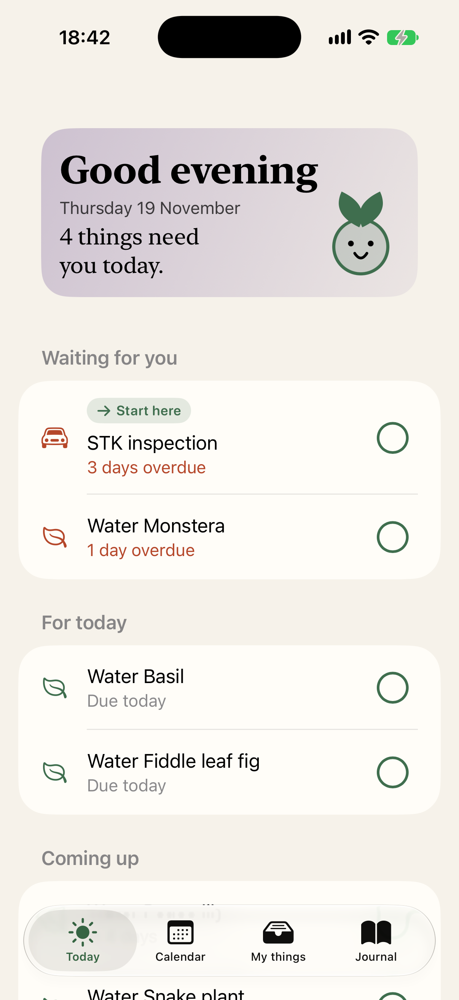
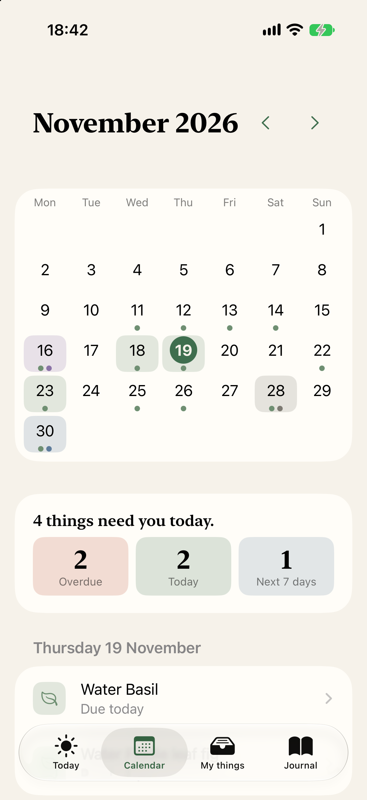
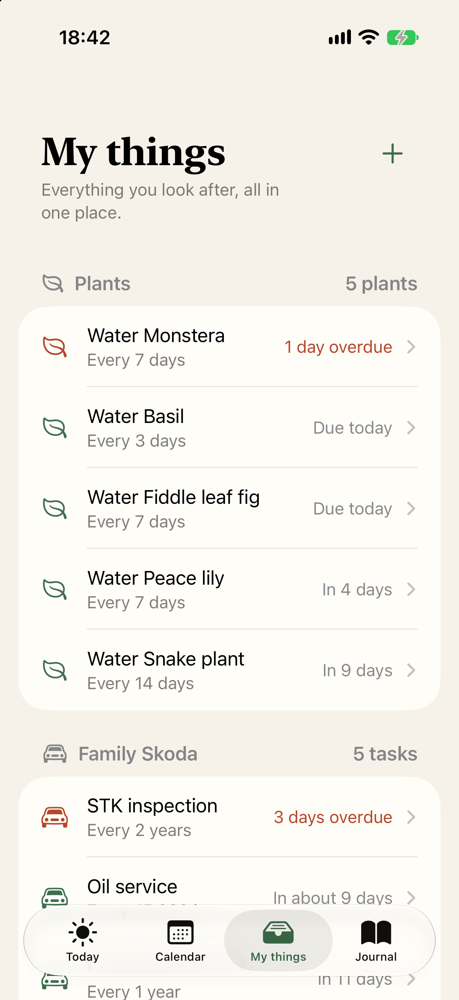
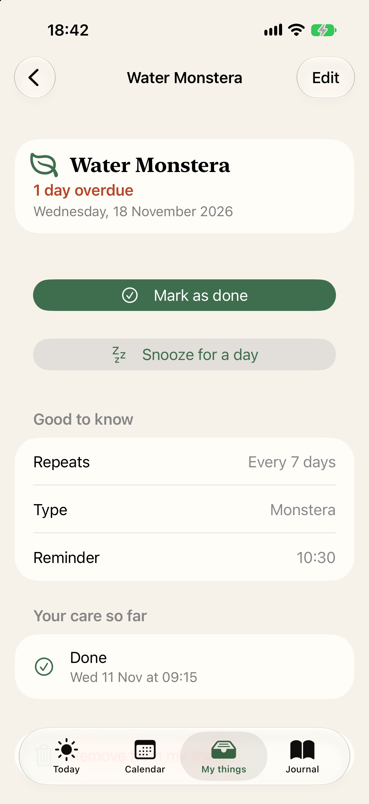
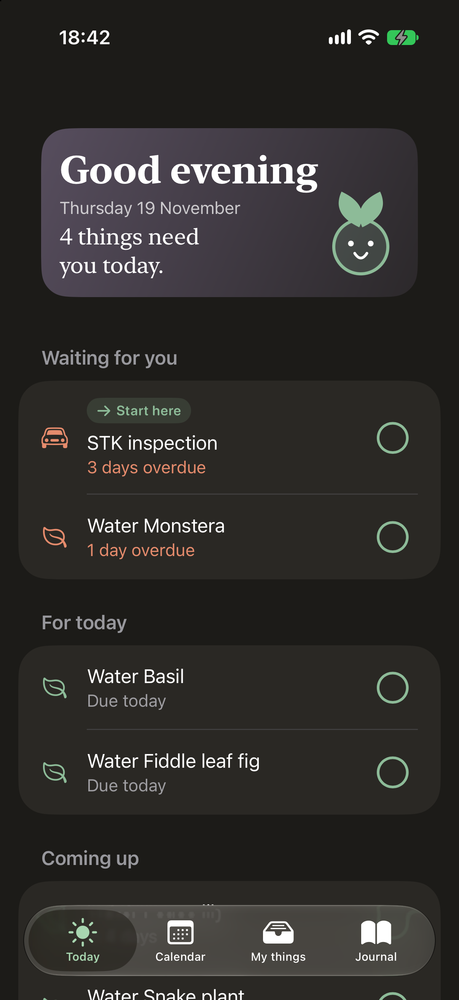
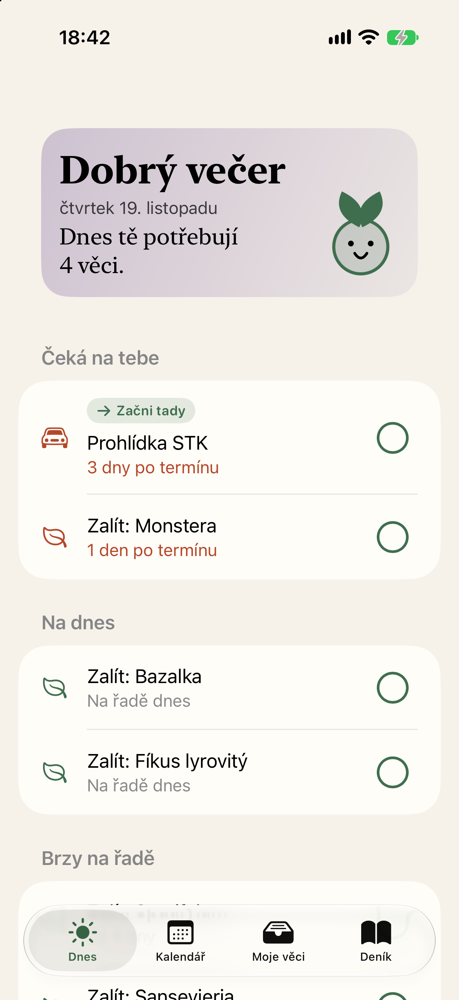

# Tend

A small iPhone app that reminds me when to water the plants and when the car needs something: STK inspection, insurance, tyre swap, oil service. Everything stays on the phone. No account, no server.

> Built with Claude Code from my requirements; I specify and review, I do not write the Swift by hand. Started November 2026. Sample data and made-up names only.

## Screenshots

Made-up sample data only. Taken in the iOS Simulator (iPhone 17, iOS 27).

| Today | Calendar | My things |
|---|---|---|
|  |  |  |

| Item detail | Dark mode | Czech |
|---|---|---|
|  |  |  |

More: [Journal](docs/screenshots/04-journal.png), [add form](docs/screenshots/06-add-form.png), [Ukrainian](docs/screenshots/09-today-ukrainian.png). A 30-second walkthrough: [docs/tend-demo.mp4](docs/tend-demo.mp4).

## What works now

- **Today**: a greeting, one warm sentence about what is waiting, then "Waiting for you" (overdue), "For today" and "Coming up" (next 30 days).
- Tap the circle to mark an item done. Swipe right to mark done, swipe left to snooze one day.
- **Calendar**: a short month grid with soft coloured dots, a summary of what needs doing, and the plan for the day you pick. Future dates are projected from each schedule.
- **My things**: plants first, then each car, soonest due first. Add, edit and delete items; plants come with a type that sets the watering interval.
- Car presets, in three groups. Deadlines: STK every 2 years, insurance, highway vignette, first-aid kit check (yearly). Servicing: oil service every 15,000 km (estimated from your odometer readings), brake fluid every 2 years, cabin filter and wipers yearly, battery check each 15 October, winter tyres by 31 October, summer tyres around 1 April. Routine care: wash the car and clean the interior weekly, check tyre pressure monthly.
- Routine care never goes overdue: a missed wash is simply there to do when you are ready, and shows in the morning note only on its own day.
- More plant types with starting watering days from general care guides (dracaena, dipladenia, campanula, camellia, strelitzia, plus the earlier ones). Dipladenia, dracaena, strelitzia and ZZ plant **follow the seasons by themselves** (northern hemisphere: summer April to September, spring/autumn March, October and November, winter December to February). Dipladenia, for example: every 4 days in summer, 7 in spring or autumn, 14 in winter. Switch "Adjust for the seasons" off to set your own. The new rhythm applies from the next watering. Other plants carry a short season tip. Pot, light and season change the real need, so it is always editable.
- **A little playfulness**: a sprout mascot on Today whose face follows the day (relaxed when nothing waits, arms up when a lot does, cheering when you finish everything; never sad, never scolding), a soft sky colour behind the greeting that follows the time of day, a **Start here** label on the one thing to begin with when two or more are waiting, and a springy tick with a few little leaves and a buzz when you finish something. The leaves and buzz can be switched off under "Little extras", and Reduce Motion turns the movement off.
- **First run**: an empty app welcomes you and offers "Add something" right on Today, instead of claiming everything is fine.
- **Journal**: everything marked done or snoozed, grouped by day.
- Light and dark mode. Works at the largest text size.
- **Reminders**: a notification on the due day at 10:30 (changeable per item), with **Done** and **Snooze for a day** buttons. For oil service, Done opens the app to ask for the odometer. Tend asks permission from a friendly card on Today, not at launch. One reminder per item, no repeats.
- **Undo** for every Done and Snooze: a bar that stays until you tap Undo or close it. No countdown to race.
- **Fresh start**: when 3 or more plants are overdue, one tap spreads them over the next days, two a day (undoable). Car deadlines are never moved.
- **Welcome back**: after 3 or more days away, one calm line about what is waiting and one small place to start. No guilt, no day counts.
- **Calm reminders**: by default one note each morning (10:30, changeable) listing what is waiting, with wording that changes day to day. It only looks 3 days ahead, so if you stop opening Tend it goes quiet by itself. You can switch to a note for each thing instead.
- **Quiet days**: pause reminders for the rest of today, 3 days or a week.
- Reminder permission is asked only after you add or finish your first thing, from a card on Today.
- A gentle check-in after the same thing is snoozed three times in a row ("Change how often", "Not now", "Don't ask again").
- **How Tend talks to you**: one sheet (bottom of Today) with every switch above.
- Made-up sample items load on the first run of a debug build.

- **Languages**: English, Czech and Ukrainian, with proper plural forms in each (1 den, 2 dny, 5 dní). Follows the phone's language. Translations were written by Claude and are waiting for a native read.
- **App icon**: the sprout, in light, dark and tinted versions. Drawn by a script (`tools/make-icon.swift`), so it can be changed and redrawn in seconds.

Not built yet: a home-screen widget, and backup and restore.

## How this was built

I am a product owner, not a developer. My part: the requirements, the product decisions, the plan for each step, and testing the result. Claude Code wrote the Swift. The routine, step by step:

1. Mockups first, then one direction chosen ("Garden notebook").
2. A short plan for each step, approved by me before any code.
3. Logic written test-first (227 tests, fixed dates, no real data), then the screens.
4. Each step checked in the simulator (light, dark, largest text, Czech, Ukrainian) before it counted as done.
5. One commit per working step. The history shows the order things were built in.

The ADHD-friendly choices (undo without a timer, a gentle "fresh start" for a pile of overdue plants, one calm morning note instead of many pings) are listed with how much evidence is behind each in [docs/design-principles.md](docs/design-principles.md). Tend is a support tool for remembering chores, not a treatment, and makes no claims about outcomes. It has no analytics and no accounts. It has no real users yet: it started in November 2026 and so far has only run in the simulator.

## Run it

Needs Xcode 27 and the iOS 27 simulator.

```bash
xcodebuild test -project Tend.xcodeproj -scheme Tend -destination 'platform=iOS Simulator,name=iPhone 17' CODE_SIGNING_ALLOWED=NO
```

Or open `Tend.xcodeproj` in Xcode and press Run.

## Tech

SwiftUI, SwiftData (local storage), Swift Testing. Minimum iOS 26. iPhone only. No third-party packages.

## Look

Direction "Garden notebook": warm paper background, moss green for actions, terracotta for overdue, serif screen titles. The calendar adds five muted tones (sage, dusk, heather, honey, stone), one per sort of task. Every task type also has its own icon, and overdue is always written in words, so colour is never the only clue.

Voice: friendly and warm, short sentences, no nagging. "Good morning", "Waiting for you", "A quiet day. Nothing planned."

## Skills used

[`swiftui-pro`](https://github.com/twostraws/SwiftUI-Agent-Skill) (code review rules, MIT, by Paul Hudson) guided the code. It is not copied into this repo; `skills-lock.json` pins the exact version, and `npx skills add twostraws/SwiftUI-Agent-Skill` installs it. A SwiftUI design skill guided the look.

## Next

1. Run it on my own iPhone and use it for real. With a free Apple account the app has to be reinstalled from Xcode every 7 days; the data stays when it is reinstalled over the old copy.
2. Backup and restore to a file, as a safety net for that.
3. A native speaker's read of the Czech and Ukrainian texts (written by Claude, not yet reviewed).

## Licence

MIT, see [LICENSE](LICENSE).
